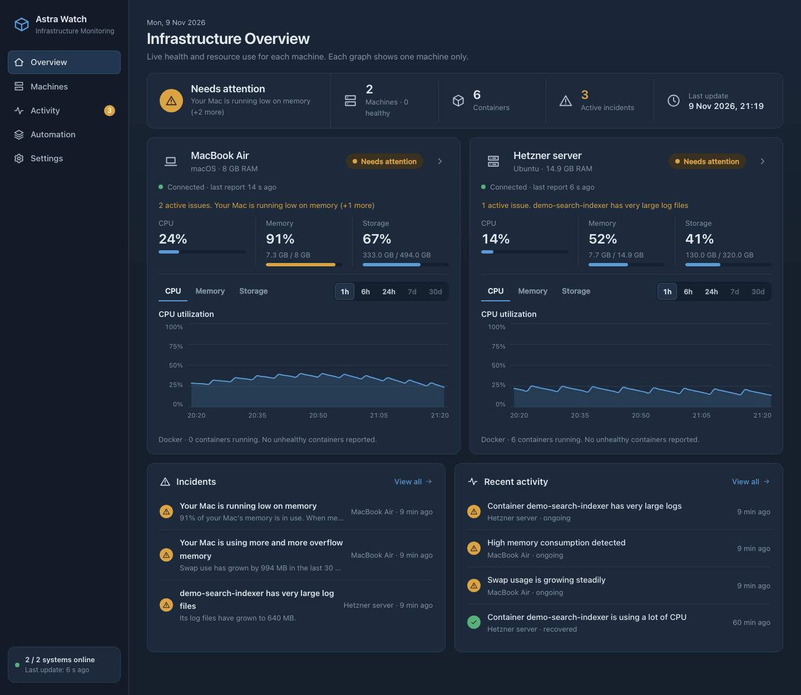
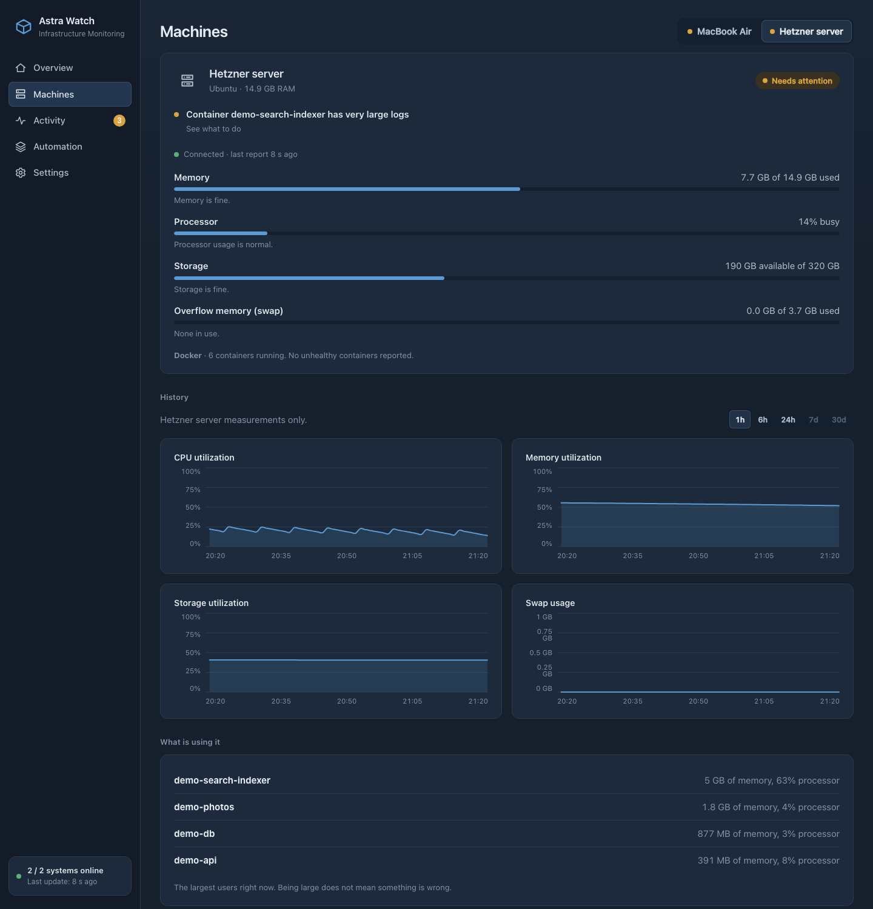
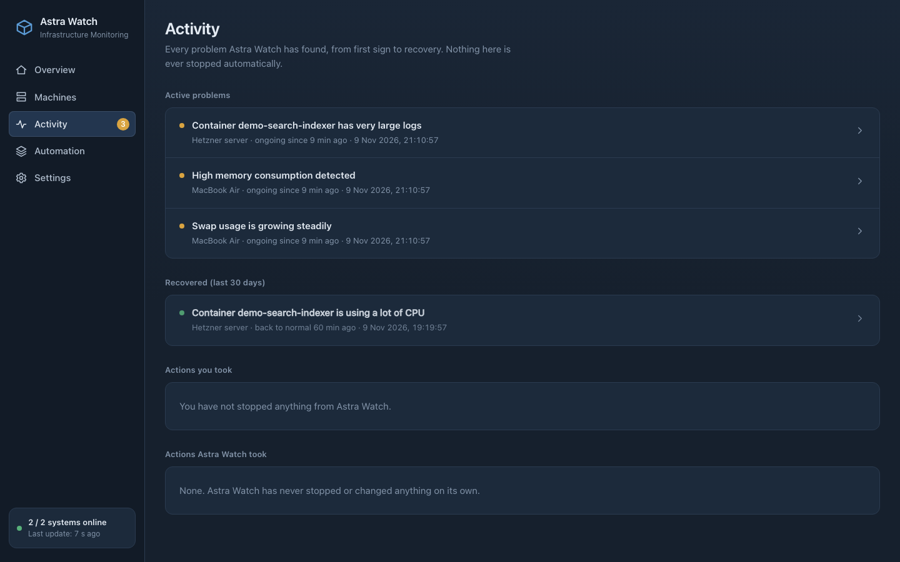
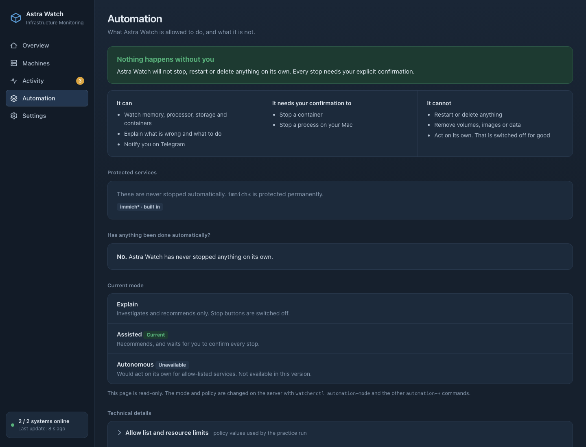
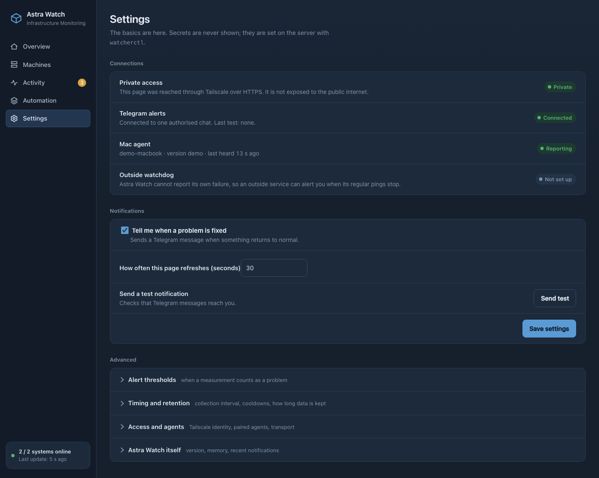
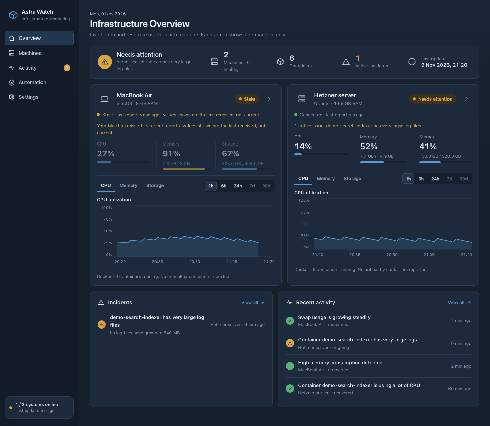
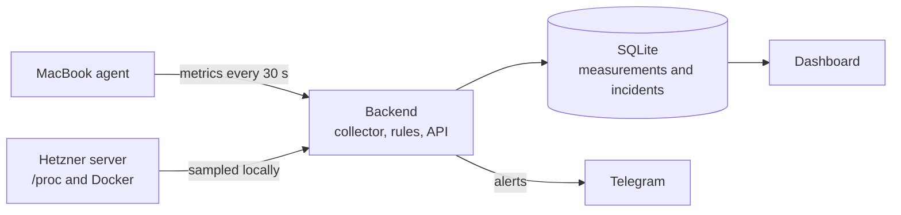

<div align="center">


# Astra Watch

**A private monitoring dashboard for a development MacBook and a remote Docker server.**

One page answers: are my machines healthy, what is using the resources, and has anything stopped reporting?

</div>


<sub>The real dashboard running on synthetic demo data. Machine names, numbers and incidents are fictional, and nothing in this repository comes from a live system.</sub>

## Why I built it

I use a MacBook for development and a rented Hetzner server that runs several Docker workloads. When something felt slow I had to look in a lot of places: CPU and memory, disk and swap, the busiest processes, the state of each container, and whether a machine was even still reporting. For the server that meant connecting to it and running commands each time.

I wanted one private page that could answer:

- Are my machines healthy, and which one is under pressure?
- What is consuming the resources?
- Are any containers unhealthy?
- Has a machine stopped reporting?
- What happened in the minutes before a problem?
- Can I check all of this from another device without exposing anything to the internet?

Astra Watch is the result. It is a personal project that solves a problem I actually had. It is not an enterprise monitoring product and makes no claims about scale.

## What it does

- **Two machines, shown separately.** A Mac (through a small agent) and a Linux server, each with its own health, connection state and graphs.
- **Connection is not health.** A machine is *Connected*, *Stale* or *Offline*. A silent machine never shows old numbers as if they were current.
- **CPU, memory, swap and storage** with 1 hour, 6 hour and 24 hour graphs.
- **What is using resources.** Top processes, plus per-container CPU, memory, health, restarts and log size.
- **Incidents with explanations.** A problem has to persist before it becomes an incident. Each one says what happened, how sure the cause is, and what to check.
- **Telegram notifications** for new incidents and recoveries, with a controlled Stop action.
- **Visible safety limits.** The Automation page shows what Astra Watch may and may not do.

## Screenshots

All screenshots are generated by [`scripts/demo_server.py`](scripts/demo_server.py) from synthetic data. [More about how they are made](docs/assets/screenshots/README.md).

| | |
|---|---|
| <br>**Machine details:** current usage, history graphs and the largest resource users | <br>**Activity:** active and recovered incidents, and the actions taken |
| <br>**Automation:** what is allowed, what needs confirmation, protected services | <br>**Settings:** connections, notifications and thresholds |
| <br>**A silent MacBook** is marked Stale and its values are labelled as not current | |

## How it works



1. The **Mac agent** samples the MacBook and sends the numbers to the backend with its own token.
2. The **backend** samples the Hetzner server itself by reading `/proc` and the Docker CLI. It does not depend on the Mac.
3. Every sample is stored in **SQLite**. After each collection a rule engine checks the thresholds.
4. A problem that lasts long enough becomes an **incident** and triggers one Telegram message. When it clears, it is marked recovered.
5. The **dashboard** only reads what is already stored, so opening it never causes a scan.
6. Everything is reached over **Tailscale**; nothing is published to the internet.

The full walkthrough, with diagrams, is in [docs/architecture.md](docs/architecture.md).

## Technology stack

Python, FastAPI and SQLite on the backend; React, TypeScript and Vite on the front end; Tailscale for private access; Docker CLI and `/proc` for measurements; launchd and the macOS Keychain on the Mac; the Telegram Bot API for alerts; systemd for the server process; pytest and Vitest for tests. Only what the code actually uses is listed, with reasons, in [docs/technology-stack.md](docs/technology-stack.md).

## Security and privacy

- The dashboard is reachable only through **Tailscale Serve**. Funnel is off and the backend listens on loopback only.
- The backend additionally accepts one authorised Tailscale identity, and requires a CSRF token for changes.
- The Mac agent and Telegram have separate credentials. Secrets are never stored in the repository or returned by the API.
- Stopping a container needs a two-step, single-use confirmation, and protected services can never be stopped.
- Metrics are kept for 24 hours, incident history for 30 days.

Details and limits: [docs/security.md](docs/security.md).

## What developers can learn from it

The project is small enough to read in an afternoon and touches a lot of real monitoring concerns: a stdlib-only agent, a heartbeat and staleness model, separating *collection* from *dashboard refresh*, persistence before alerting, incident recovery, safe operational actions and private deployment. See [docs/learning-outcomes.md](docs/learning-outcomes.md), which also includes what I learned building it.

## Documentation

| Document | Covers |
|---|---|
| [Architecture](docs/architecture.md) | Components, diagrams, and a metric's journey through the system |
| [Technology stack](docs/technology-stack.md) | Each technology, what it does here and why |
| [Monitoring lifecycle](docs/monitoring.md) | Intervals, connectivity, thresholds, incidents, recovery, retention |
| [Security](docs/security.md) | Access layers, secrets, confirmations, limits |
| [Learning outcomes](docs/learning-outcomes.md) | What to study here, and what I learned |
| [Setup](docs/SETUP.md) | Deploying it yourself |

## Try it locally

You can run the dashboard on synthetic data without any real machine:

```bash
python3 -m venv .venv && .venv/bin/pip install -r backend/requirements.txt
(cd frontend && npm ci && npm run build)
.venv/bin/python scripts/demo_server.py      # http://127.0.0.1:8300
```

Tests: `cd backend && ../.venv/bin/pip install -r requirements-dev.txt && ../.venv/bin/python -m pytest tests` and `cd frontend && npm test`.

Code map: `backend/` (API, collection, rule engine, tests), `frontend/` (dashboard), `agent/` (Mac agent), `deploy/` (release and rollback scripts), `scripts/` (demo server), `site/` (static landing page).

## Status and limitations

In daily personal use. It monitors exactly two machines (one Mac, one Linux server) for a single owner and keeps 24 hours of metrics. If the server itself is down it cannot alert on its own; an optional outbound heartbeat to an external service covers that. Read the code before trusting it with your own infrastructure. Issues and pull requests are welcome.

## License

[MIT](LICENSE)
