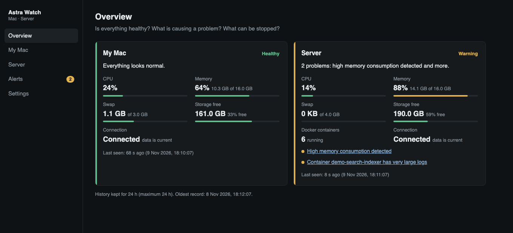
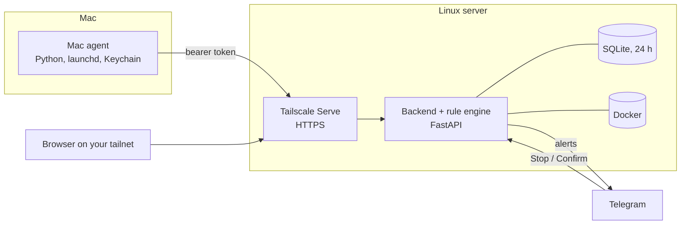
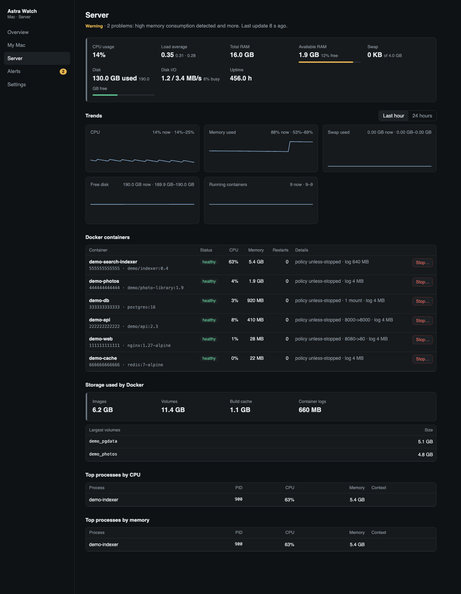
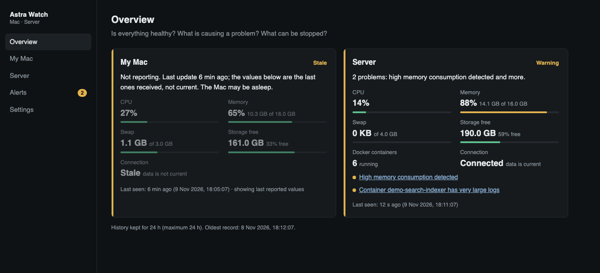
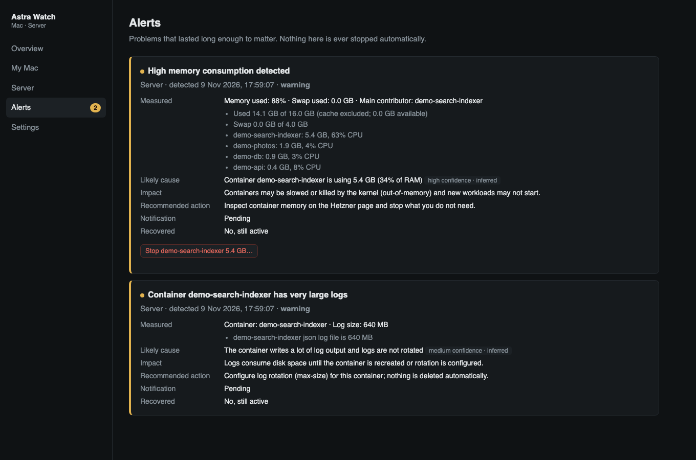

# Astra Watch

**Private infrastructure monitoring for personal devices and servers.**

An open-source personal project: one lightweight dashboard for a MacBook and a Linux server, reachable only over Tailscale.

Real dashboard running on synthetic demo data. No live machines appear in any screenshot.

## Why I built it

Managing multiple development machines and self-hosted services often means switching between terminal commands, Docker tools and different monitoring views just to understand what's happening.

I ran into this with my MacBook and a remote Linux server running several Docker-based workloads. When a machine got slow or a container started using too many resources, I had to check CPU, memory, disk space, running processes and container status separately, and connect to the server by hand to do it.

I wanted a simpler way to answer: *Are my machines healthy? What is consuming resources? Which containers need attention? Has a device stopped reporting? Can I check all of this securely while I'm away from my workstation?*

That led me to build Astra Watch: a lightweight application that brings system metrics, process visibility, Docker monitoring and alerts into one private dashboard.

It is a personal project that solves a problem I actually had. It is not an enterprise monitoring platform, but other developers and self-hosters are welcome to explore and extend it.

## What it does

- **Two machines, one view.** A Mac (via a small agent) and a Linux server, each marked **Connected**, **Stale** or **Offline** with a last-seen time. Old numbers are never shown as current.
- **CPU, memory, swap, disk** with 1 h / 24 h trends.
- **Processes and Docker.** Top processes, per-container CPU, memory, health, restarts and log size.
- **Alerts with explanations.** A problem must persist before it alerts; incidents show cause, impact and a suggested action.
- **Telegram notifications**, one per incident, plus a recovery message.
- **Controlled stop.** A container can be stopped only after an explicit, single-use confirmation.
- **Private by design.** Tailscale-only access, HTTPS, one authorised identity, Funnel disabled.

## Architecture

The Mac agent reports every 30 seconds. The server collects its own metrics independently, stores them in SQLite, evaluates alerts and talks to Telegram. The dashboard reads stored data every 30 seconds and never triggers collection. See [docs/architecture.md](docs/architecture.md).

## Technology stack

Python 3.12 · FastAPI · Uvicorn · SQLite · Docker CLI · Tailscale · systemd user services · launchd and macOS Keychain · Telegram Bot API · React 18 · TypeScript · Vite · pytest.
Each choice and the reason for it: [docs/technology-stack.md](docs/technology-stack.md).

## Security and privacy

- The live dashboard is **private**; it is not published anywhere. Remote access is through Tailscale Serve, **Funnel is disabled**.
- Network access and application login are separate layers: the backend also requires the one authorised Tailscale identity and CSRF tokens for changes.
- The Mac agent and Telegram have their own credentials.
- Stop actions are allowlisted and need a two-step confirmation.
- No secrets, databases or infrastructure details are in this repository.

Full explanation: [docs/security.md](docs/security.md).

## Screenshots

| | |
|---|---|
|  |  |
|  |  |

All generated from synthetic data with [`scripts/demo_server.py`](scripts/demo_server.py).

## Documentation

- [Architecture](docs/architecture.md) · [Technology stack](docs/technology-stack.md) · [Monitoring and alerting](docs/monitoring.md) · [Security](docs/security.md) · [Setup](docs/SETUP.md)
- Try it locally on fake data: `python scripts/demo_server.py` (after building `frontend/`).
- Code map: `backend/` (API, rule engine, tests), `frontend/` (dashboard), `agent/` (Mac agent), `deploy/` (release and rollback scripts), `site/` (public landing page).

## Project status and limitations

Working and in daily personal use. Limitations: exactly two machines (one Mac, one Linux server), a single owner, 24 hours of history, and no alerting if the server itself is down. Read the code before trusting it with your own infrastructure.

## License

[MIT](LICENSE) © ShivaSai06
