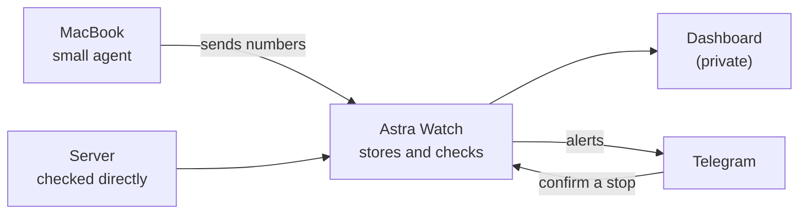

<div align="center">


# Astra Watch

**A single place to see what's happening across your computers and servers, understand problems, and take action when needed.**

</div>


## Why I built it

I develop on a MacBook, and I rent a small server that runs several applications for me.

When something got slow, I never knew where to look. Was my laptop out of memory? Which program was eating it? Was the server struggling, or was one of its apps misbehaving? Had one of the machines simply stopped reporting? Answering that meant checking different tools, and for the server it meant logging in and typing commands, every time.

I wanted one page that could just tell me what was going on, warn me when something needed attention, and let me decide what to do about it. So I built it.

## What it helps with

- **See all your machines in one place.** Your laptop and your server, side by side, each with its own health.
- **Find what is using up your computer.** Which programs, and which server apps, are taking the most.
- **Notice trouble early.** A machine that is running low on memory, storage or processing power is flagged before it becomes a crisis.
- **Know when a machine goes quiet.** If a machine stops reporting, it says so, rather than showing old numbers as if they were current.
- **Get a message when it matters.** Telegram notifications when a problem starts and when it clears.
- **Understand before you act.** Each problem is explained in plain language, with a likely cause and what to check.
- **Stay in control.** Astra Watch never stops anything on its own. Stopping a program or server app always needs your confirmation.

You do not need to know what a container or a CPU core is to use it. If you have ever wondered "why is my computer slow?", this is for that question.

## See Astra Watch

These screenshots show the actual Astra Watch interface using sample data. No information from a live machine is included.

| | |
|---|---|
| <br>**A closer look at one machine:** how much it is using, how that changed over time, and what is using it | <br>**Activity:** problems happening now, and ones that have cleared |
| <br>**A machine that went quiet** is marked as such, and its numbers are labelled as out of date | <br>**What Astra Watch may and may not do:** nothing happens without you |
| <br>**Settings:** private access, Telegram and notifications | |

## How it works

1. Astra Watch collects information from the computers and servers you want to watch.
2. It brings that information into one place.
3. It keeps checking for anything that may need attention, such as memory running low.
4. Problems and changes appear on the dashboard.
5. It can send a notification so you know when something happens.
6. You look into the problem and decide what to do.



The dashboard is only reachable over a private Tailscale network, not the public internet. A problem has to last a few minutes before it counts, so a brief spike does not wake you up. The dashboard only reads what has already been collected, so opening it never puts extra load on your machines.

## Built with

- **Python and FastAPI**: the backend that collects, checks and serves everything. Python makes reading system information easy, and FastAPI keeps the web API small and well-validated.
- **SQLite**: stores the measurements and problems in a single file. A database server would be overkill for two machines.
- **React, TypeScript and Vite**: the dashboard you see. TypeScript catches mistakes in how the screens use the data.
- **A small Python agent on the Mac**: runs in the background with launchd and keeps its access key in the macOS Keychain, so there is nothing to set up on the laptop beyond installing it.
- **Docker command line and Linux `/proc`**: how the server's own usage and its apps are read, with read-only access.
- **Tailscale**: a private network between my own devices, so the dashboard is never exposed publicly.
- **Telegram Bot API**: phone notifications, and the confirm button for stopping something.
- **systemd**: keeps the backend running on the server with limits on how much it may use.
- **pytest and Vitest**: tests for the rules, the security checks and the screens.

## What I learned

- **Collecting from different machines is two problems.** My Mac pushes its numbers to the server, while the server reads its own. They end up in the same format, but how they arrive is very different.
- **"Slow" needs a cause.** A big number is not an explanation. Showing which program is using the most is useful, but I label it as the largest user, not as the proven cause.
- **Silence is not the same as healthy.** A sleeping laptop stops reporting. I keep "is it okay?" separate from "is it still reporting?" so old numbers are never shown as current.
- **Problems need a lifecycle.** A short spike is ignored. A lasting problem becomes one tracked incident, and it is marked recovered only after it has stayed fixed for a while.
- **Notifications need restraint.** One message per problem, a cooldown against repeats, and one message when it clears.
- **Private by default.** The backend only listens locally. Tailscale provides access, and the app also checks that it is me.
- **Risky actions need a brake.** The only thing it can do is stop a container or a Mac process, and only after a single-use confirmation. Some services are protected and can never be stopped from it.
- **Keep the monitor honest about itself.** It runs on the server it watches, so it cannot report that server dying. An optional outside heartbeat can cover that.

## Try it yourself

You can run the dashboard on made-up data, no real machine needed:

```bash
python3 -m venv .venv && .venv/bin/pip install -r backend/requirements.txt
(cd frontend && npm ci && npm run build)
.venv/bin/python scripts/demo_server.py     # then open http://127.0.0.1:8300
```

The sample machines, numbers and incidents are generated by `scripts/demo_server.py` in a temporary folder. To monitor your own machines, follow [docs/SETUP.md](docs/SETUP.md). It is a personal project that has only been tried with one Mac and one Linux server, so please read the code before trusting it with anything important.

The `docs/` folder has deeper write-ups (architecture, security, monitoring rules) for anyone who wants to study the implementation. They are optional.

## License

[MIT](LICENSE)
