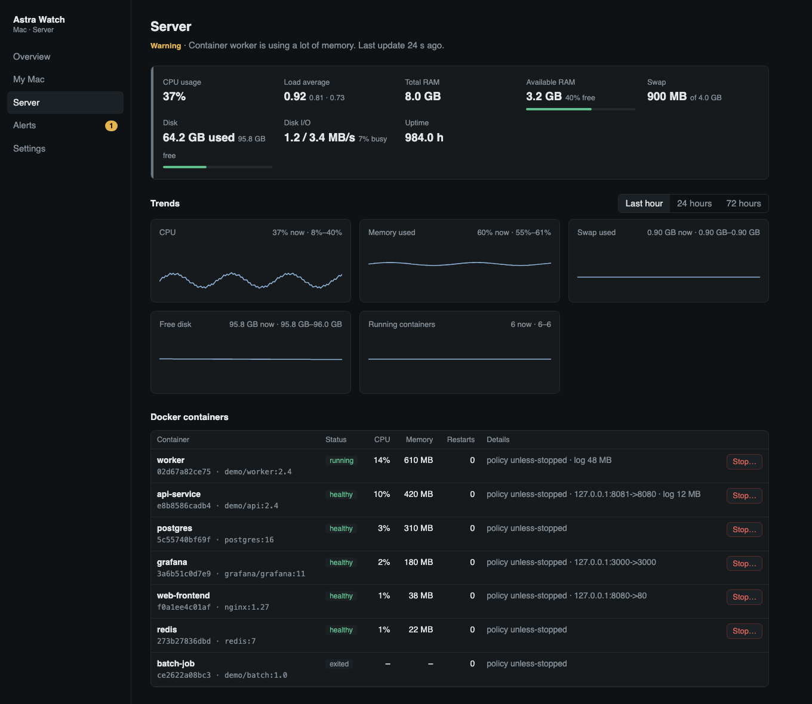
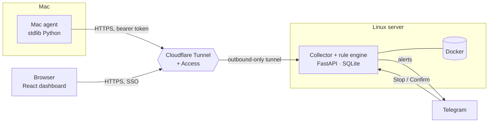

<div align="center">

# Astra Watch

**A small, self-hosted watchtower for your dev Mac and your Linux server — with a human in the loop.**

</div>


<sub>Dashboard shown with synthetic demo data.</sub>

## What it is

Astra Watch answers three questions at a glance: *Is everything healthy? What is causing a problem? What can I safely stop?*

A lightweight collector runs on a Linux server and a tiny agent runs on a Mac. A rule engine turns raw numbers into
plain-language alerts (cause, impact, recommendation), sends them to Telegram, and lets you stop a runaway container or
process after an explicit two-step confirmation. Nothing is ever stopped automatically.

> **Personal project.** I built this for my own server and laptop and run it in production for myself. It is shared as a
> portfolio piece and a reference, not as a supported product. Read the code before you trust it with your infrastructure.

## Features

- **Two machines, one view** – CPU, memory, swap, disk, load and trends (1 h / 24 h / 72 h) for a Mac and a Linux server.
- **Explains problems** – alerts include the measured value, likely cause, impact and a suggested action; they must persist before firing, so they don't flap.
- **Docker aware** – per-container CPU/memory, restart loops, unhealthy or stopped containers, oversized logs, Docker disk usage.
- **Telegram alerts with Stop buttons** – long-poll or webhook mode; stopping needs a confirmation step.
- **Mac development workloads** – spots runaway Node/Vitest workers, orphaned processes and Docker Desktop memory.
- **Quiet and bounded** – history is capped at 72 h, and the service runs with systemd memory/CPU limits.

## Architecture



The server binds to `127.0.0.1` only; the public hostname is reachable solely through an outbound Cloudflare Tunnel.

## Tech stack

| Layer | Technology |
|---|---|
| Backend | Python 3.12, FastAPI, Uvicorn, SQLite |
| Dashboard | React 18, TypeScript, Vite |
| Mac agent | Python standard library only, launchd, macOS Keychain |
| Deployment | systemd user services, release directories with automatic rollback |
| Edge | Cloudflare Tunnel and Cloudflare Access |
| Tests | pytest (65 tests: engine, approvals, security, agent) |

## Security and access

Three independent trust domains, each with its own credential:

| Who | How they authenticate |
|---|---|
| Dashboard (you) | Cloudflare Access JWT verified by the app itself, plus CSRF tokens on every state change. Fails closed if Access isn't configured. |
| Mac agent | Per-agent bearer token, stored only as a SHA-256 hash on the server and in the macOS Keychain on the Mac. Revocable and rotatable. |
| Telegram | Secret webhook header, plus an allow-listed user id and private chat id. |

Other safeguards:

- **Stop is a two-step, single-use approval** bound to the exact target by HMAC. The only mutating Docker call is `docker stop` on a validated 64-hex container id; the agent re-verifies process identity and sends SIGTERM, never SIGKILL.
- **Rate limiting**, request-size limits, strict security headers and a restrictive Content-Security-Policy.
- **Secrets stay out of the database** and out of the repository (`0600` files; the Telegram token is scrubbed from error messages).
- **Privacy:** the Mac agent reads process command lines locally to classify workloads, but sends only labels, executable paths and resource numbers.

> Note: the server user is in the `docker` group, which is root-equivalent on that host. Safety therefore comes from the code paths above, so review them for your own setup.

## Getting started

Requirements: a Linux server with Python 3.12 and systemd user services, SSH access, a Telegram bot (from @BotFather) and,
for remote access, a Cloudflare account. Node and Python 3.12+ on your workstation.

```bash
# 1. Run the tests and build the dashboard
python3 -m venv .venv && .venv/bin/pip install -r backend/requirements-dev.txt
(cd backend && ../.venv/bin/python -m pytest -q)
(cd frontend && npm ci && npm run build)

# 2. Point the deploy scripts at your server (this file is git-ignored)
cp deploy/local.env.example deploy/local.env && $EDITOR deploy/local.env

# 3. Build, upload and activate a release (rolls back automatically if the health check fails)
./deploy/deploy.sh
```

Then finish the one-time setup on the server (Telegram token, Cloudflare Tunnel and Access) following
[docs/SETUP.md](docs/SETUP.md), and install the Mac agent:

```bash
./agent/install.sh            # asks for your dashboard URL and agent token; no sudo
watcher-agent start           # also: stop | status | logs | enable | disable
```

### Configuration

| Item | Where |
|---|---|
| Thresholds, intervals, retention | Dashboard → Settings (`settings.json`) |
| Telegram token, Cloudflare Access ids | `~/pi-watcher/config/secrets.env` on the server, written by `watcherctl` |
| Agent tokens | Created with `watcherctl pair-agent`; only hashes are stored |
| Deploy target | `deploy/local.env` (`WATCHER_HOST`, `WATCHER_KEY`) |
| Public URL (links in alerts) | `public_url` in `settings.json`; the default `https://monitor.example.com` is a placeholder |

## Repository layout

```
backend/    FastAPI app, rule engine, Telegram client, admin CLI (watcherctl), tests
frontend/   React + TypeScript dashboard
agent/      Mac agent and launchd helper
deploy/     Release-based deploy, rollback and systemd units
docs/       Setup guide
```

## License

[MIT](LICENSE) © ShivaSai06
