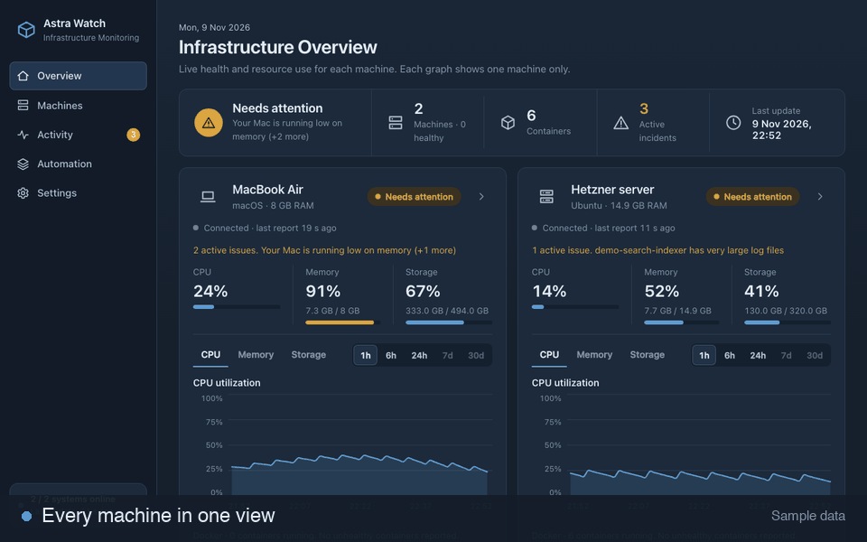

# Astra Watch

**Know what's happening across your machines.**

A private dashboard that brings the health, resource use and alerts for a computer and its servers into one place.

**[See how it works: shivasai06.github.io/astra-watch](https://shivasai06.github.io/astra-watch/)**

The actual Astra Watch interface using sample data. No information from a live machine is included.

From the dashboard you can see every machine side by side, check what is using its resources, read a plain-language explanation of any problem, notice when a machine goes quiet, and see exactly what Astra Watch is and is not allowed to do.

## Why it exists

I develop on a MacBook and run my apps on a remote Linux server. When something got slow, I had to open one tool after another and log in to the server to find the cause. Astra Watch puts that information in one private place, tells me when something needs attention, and lets me decide what to do. It never stops anything without my confirmation.

It is a personal project built for my own setup. Other people are welcome to read it, learn from it and build on it.

## In the repository

- `backend/`, `frontend/`, `agent/`: the monitoring service, the dashboard and the Mac agent.
- `docs/`: technical notes for anyone studying the implementation (architecture, security, monitoring rules, setup).
- `site/`: the landing page linked above.
- `scripts/demo_server.py`: runs the dashboard on made-up data, without any real machine.

## License

[MIT](LICENSE)
