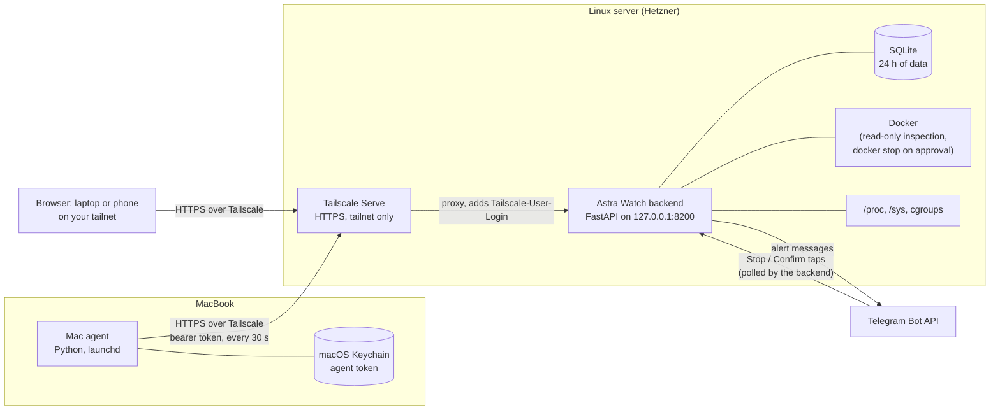
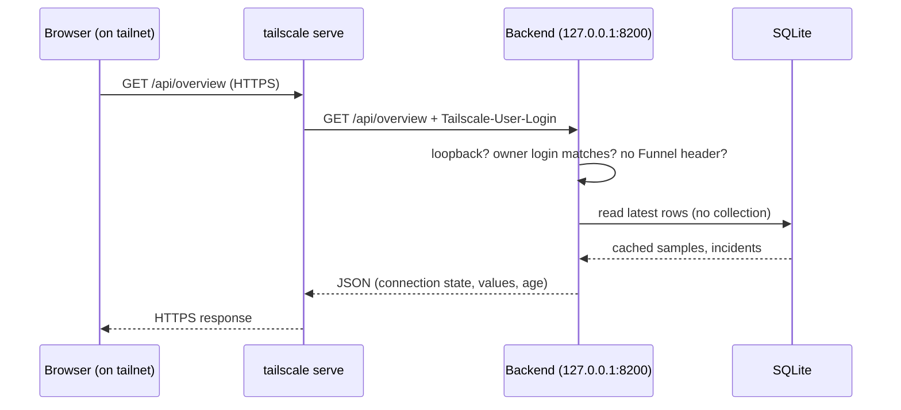

# Architecture

This describes what Astra Watch actually does today, not an idealised design.

## The big picture

There are three programs: the **Mac agent**, the **backend** (which also collects the server's own metrics and serves the dashboard), and the **React dashboard** (static files served by the backend). SQLite, Tailscale and Telegram are the supporting pieces.

## 1. MacBook monitoring agent

`agent/mac_agent.py` is a single Python file using only the standard library. It runs under **launchd** (`RunAtLoad` and `KeepAlive`), so it starts at login and is restarted if it crashes. Every 30 seconds it reads CPU, memory, swap, disk, load and top processes (plus Docker Desktop containers if Docker runs), and sends them to the backend with `POST /agent/v1/metrics`. It also long-polls `GET /agent/v1/commands` so the backend can ask it to stop a process after you approve.

Its token lives in the **macOS Keychain** (service name chosen at install). The agent reads process command lines locally to classify them (for example "Node dev server") but only sends labels, executable paths and numbers.

## 2. Hetzner monitoring backend

`backend/watcher/` is a FastAPI application run by Uvicorn as a **systemd user service** (`infra-watcher`). It listens on `127.0.0.1:8200` only, with a 300 MB memory cap and 60 % CPU cap. One process does everything: HTTP API, collection, rule engine, Telegram. Background loops are `asyncio` tasks (`collect_loop`, `maintenance_loop`, `telegram_poll_loop`).

## 3. System metrics collection

The server's own metrics come from `collect_linux.py`, which reads `/proc` and `/sys` directly (CPU ticks, `/proc/meminfo`, load, disk free, disk I/O) rather than running shell commands. Every **30 seconds** (`refresh_interval`) `collect_loop` takes one sample and stores it. Process lists refresh every 60 seconds.

## 4. Docker metrics collection

`docker_cli.py` calls the `docker` command line with read-only subcommands (list, inspect, df). Container metadata refreshes every 60 s; per-container CPU and memory come from cgroup files each cycle, so no `docker stats` stream is held open. Container log sizes are measured every 15 minutes. The one write operation is `docker stop` (see section 12).

## 5. Metrics ingestion and authentication

The Mac's `POST /agent/v1/metrics` is checked by `agent_auth`: the bearer token is hashed (SHA-256) and compared with `agents.json`, which stores only hashes. Failed attempts are rate-limited per IP, the payload is validated (CPU 0–100 and so on) and capped at about 512 KB. The backend stamps each sample with its **own** clock, so a Mac with a wrong clock cannot poison history.

## 6. SQLite data storage

One SQLite file (WAL mode). Main tables:

| Table | Holds |
|---|---|
| `samples` | one row per collection per machine: CPU, load, memory, swap, disk |
| `snapshots` | JSON blobs: process lists, container lists, Docker disk usage |
| `incidents` | alerts: state (active / recovered), cause, impact, recommendation |
| `pending` | problems seen but not yet persistent enough to alert |
| `approvals`, `audit` | stop confirmations and a log of who did what |
| `notifications`, `logs`, `kv` | delivery log, app diagnostics, small key/value state |

Secrets are **not** in the database; they live in `secrets.env` (mode 0600) beside it.

## 7. Alert evaluation and persistence

After each collection the rule engine (`engine.py`) evaluates every rule against recent samples. A problem first becomes *pending*. Only if it is still present after the persistence time (default 180 s; CPU 300 s) does it become an *active incident*. It recovers after staying clear for 120 s. Details and examples: [monitoring.md](monitoring.md).

## 8. Telegram notification delivery

`notify.py` sends one message per new incident through the Telegram Bot API, with the measured values, likely cause and Stop buttons where applicable. Deduplication, a cooldown and one recovery message are covered in [monitoring.md](monitoring.md). In production the bot is **polled** (`TELEGRAM_MODE=polling`): the backend asks Telegram for button taps, so no public URL is needed.

## 9. Tailscale private networking

Tailscale builds a private WireGuard network (a "tailnet") between your own devices. The server runs `tailscaled` as a user service in userspace mode (`infra-tailscaled`), so no root or kernel changes are needed. Only devices signed in to your tailnet can even reach the server. Funnel, Tailscale's feature for exposing a service to the public internet, is **disabled**.

## 10. Tailscale Serve and HTTPS

`tailscale serve` takes HTTPS connections on the machine's `*.ts.net` name (with a certificate Tailscale issues) and proxies them to `http://127.0.0.1:8200`. The backend therefore never speaks TLS itself and is never bound to a public interface.

## 11. Dashboard access authentication

Being on the tailnet is not enough for the dashboard API. `tailscale serve` adds a `Tailscale-User-Login` header with the identity it authenticated. The backend (`security.tailscale_owner_ok`) accepts a request only if all of these hold: the peer is loopback, the header equals the one configured owner login, and there is no Funnel header. Anything else gets `403`. State-changing calls also need a CSRF token. Details: [security.md](security.md).

## 12. Controlled container stop operations

Nothing is ever stopped automatically. Stopping is two steps: **prepare** (the backend validates the target and returns a single-use token valid for 120 s, bound to the exact container id by an HMAC) and **confirm** (the token is spent). Only `docker stop` on a validated 64-hex container id is allowed; there is no kill, rm or exec. On the Mac, the agent re-checks the process identity and sends SIGTERM, never SIGKILL. Every step is written to the audit table.

## 13. 24-hour retention and cleanup

All time-based data is deleted once it is older than the retention window. The window is 24 hours and cannot be raised above that (settings may only lower it). Cleanup runs at service start and then hourly; a daily database backup is kept for at most 24 hours, config backups for 7 copies.

## Data flow

**Mac to server:** agent samples locally, then `POST /agent/v1/metrics` over Tailscale, token verified, rows inserted into `samples` and `snapshots`, `last_seen` updated.

**Server to itself:** `collect_loop` reads `/proc` and Docker, inserts rows, then runs `engine.tick` and the notifier. This does not depend on the Mac.

**Alert to phone:** engine opens an incident, the notifier sends one Telegram message, you may tap Stop, the backend polls that tap, asks you to confirm, then runs `docker stop`.

**Browser:** the page fetches `/api/overview` and friends every 30 s. These endpoints read what is already in SQLite; they do not collect anything.

## Request / response flow (dashboard)

## Security boundaries

1. **Network:** only your tailnet reaches the server; Funnel off; backend on loopback.
2. **Dashboard user:** one Tailscale identity, plus CSRF on writes.
3. **Mac agent:** its own bearer token (hash on server, Keychain on Mac), revocable.
4. **Telegram:** secret header (webhook mode only), allow-listed user id and private chat id.
5. **Actions:** two-step, single-use, HMAC-bound approval; allowlisted operations only.

## Honest limitations

- The server user is in the `docker` group, which is root-equivalent on that host. Safety comes from the code paths above, so review them for your own setup.
- Two machines are hard-wired (`mac`, `hetzner`); this is not a general fleet monitor.
- Data older than 24 hours is gone by design; there is no long-term history.
- If the server itself is off, nothing can alert you; an external uptime check is recommended (see SETUP).
